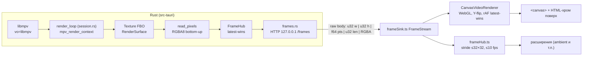
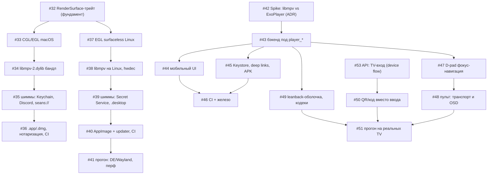

# Порты платформ: матрица готовности, RenderSurface, ADR

Единый план портов Seans-клиента за пределы Windows: macOS, Linux, Android,
Android TV. Документ собирает размазанное по issues #32–#53: платформенную
матрицу, контракт `RenderSurface`, архитектуру кадр-стрима, критерии spike'ов
и порядок работ. Детали конкретной задачи остаются в теле её issue; здесь —
связи, контракты и решения.

- **Статус:** живой план; редактируется по мере закрытия spike'ов и портов.
- **Код базовой линии (Windows):** `src-tauri/src/player/*`
  (`host.rs`, `gl.rs`, `session.rs`, `frames.rs`, `ffi.rs`, `commands.rs`),
  `src/features/player/frameSink.ts`, `src/features/player/extensions/frameHub.ts`.
- **Задачи:** milestone'ы `macOS`, `Linux`, `Android`, `TV (Android TV)`.

---

## 1. Платформенная матрица готовности

| Платформа | Статус | Оценка | Главные блокеры | Задачи |
|---|---|---|---|---|
| **Windows** | ✅ база: кадр-стрим работает | — | — | shipped (M7) |
| **macOS** | не начат | M: 5 задач, ~2–3 нед | сначала #32 (трейт); нотаризация и hwdec-videotoolbox в CI | #32–#36 |
| **Linux** | не начат (ждёт #32) | M: 5 задач, ~2–3 нед | выбор дистрибутива libmpv (#38); матрица DE/Wayland и перф readback (#41) | #37–#41 |
| **Android** | spike не начат | L: 5 задач, ~3–4 нед | **решение #42 (libmpv NDK vs ExoPlayer)** — от него зависит весь пайплайн; updater на Android не работает (#45) | #42–#46 |
| **Android TV** | не начат (ждёт Android) | M: 6 задач, ~2–3 нед поверх Android | TV-вход требует API бэкенда (#50 / #53); слабые SoC и кодеки (#49, #51) | #47–#51, #53 |

Оценки — T-shirt, по масштабу задач (в issues оценок нет). Порядок внутри
платформ — раздел 5.

Общие для всех платформ риски:

- **CPU-readback кадр-стрима** — главный перф-риск портов (раздел 3.3).
  На Windows замерен qualitatively; численные бюджеты — в разделе 4.2, замеры
  на целевом железе — критерий готовности #41 и #51.
- **Платформенные шиммы** (keyring, Discord RPC, `seans://`) повторяются по
  платформам (#35 / #39 / #45) — контракт один, реализация per-OS.
- **Контракт `player_*` команд и `player://state` не меняется** ни на одной
  платформе (#43): TS-слой (`usePlayer.ts`, `mpvBridge.ts`, `frameSink.ts`)
  пишется один раз.

---

## 2. Контракт `RenderSurface`

Фундамент всех портов (#32). Сегодня платформенное сидит в двух файлах:
`host.rs` (скрытое Win32-окно как якорь WGL) и `gl.rs` (WGL + offscreen FBO +
`glReadPixels`). Задача #32 — вынести трейт, а WGL-имплементацию упрятать за
`#[cfg(windows)]`, не трогая `session.rs`, `ffi.rs`, `frames.rs` и TS-слой.

### 2.1 Методы

```rust
/// Создаётся и живёт на render-потоке (тот, кто зовёт attach/resize/read_pixels).
trait RenderSurface {
    /// Контекст + texture-backed FBO; контекст становится current на этом потоке.
    /// `anchor` — платформенный якорь (см. 2.2); там, где он не нужен, игнорируется.
    fn attach(anchor: isize, width: i32, height: i32) -> Result<Self, String>
        where Self: Sized;

    /// Пересоздаёт FBO под новый размер (no-op при совпадении). Минимум 2×2.
    fn resize(&mut self, width: i32, height: i32) -> Result<(), String>;

    /// RGBA8, tightly packed (PACK_ALIGNMENT=1), строки bottom-up (GL-порядок).
    fn read_pixels(&self) -> Vec<u8>;

    // --- сопутствующее для mpv render API (то, что уже есть у GlSurface) ---
    fn proc_address_fn(&self) -> (MpvGetProcAddressFn, *mut c_void);
    fn fbo_id(&self) -> i32;            // mpv_opengl_fbo.fbo
    fn internal_format(&self) -> i32;   // mpv_opengl_fbo.internal_format (GL_RGBA8)
    fn size(&self) -> (i32, i32);
}
```

Инварианты (общие для всех имплементаций):

1. **Render-thread affinity** — контекст привязан к потоку, создавшему его в
   `attach`; `session.rs` поднимает render-поток и владеет поверхностью до teardown.
2. **Рендерим в texture-backed FBO, а не в default framebuffer** — hidden-window
   backbuffers давали all-zero readback (см. комментарий в `gl.rs`).
3. **Формат кадра на выходе фиксирован**: RGBA8, bottom-up, `w * h * 4` байт —
   wire format `frames.rs` и шейдер Y-flip в `frameSink.ts` завязаны на это.
4. **Самопроверка при attach** (как в `gl.rs`): clear в красный → `read_pixels`
   → пишет в лог; чёрный ответ = сломан readback, ошибка русской строкой.
5. **Минимальный размер 2×2**; `resize` с тем же размером — no-op.

Открытая деталь для #32: форма `attach` (opaque `anchor: isize`, который на
Windows остаётся HWND скрытого окна `SeansMpvHost`, либо платформа сама создаёт
якорь внутри имплементации). Требование: вызов в `session.rs` не меняется
поведенчески, CGL/EGL/GLES-имплементации не требуют правок `session.rs`.

### 2.2 Что скрыто за трейтом

| Подсистема | Windows (сейчас) | macOS (#33) | Linux (#37) | Android (если libmpv, #42) |
|---|---|---|---|---|
| Контекст | **WGL** (`wglCreateContext` на HDC скрытого окна) | **CGL** (или EGL через ANGLE) | **EGL surfaceless** (`EGL_KHR_surfaceless_context`, fallback — pbuffer) | **GLES 2/3** через EGL (pbuffer/surfaceless) |
| Якорь окна | скрытое Win32-окно `SeansMpvHost` (`host.rs`, `CS_OWNDC`, never `WS_VISIBLE`) | **не нужен** — контекст без host-окна | **не нужен** | **не нужен** |
| Render target | texture FBO (RGBA8) | texture FBO (RGBA8) | texture FBO (RGBA8) | texture FBO (RGBA8) |
| Readback | `glReadPixels` (PACK_ALIGNMENT=1) | `glReadPixels` | `glReadPixels` | `glReadPixels` |
| Загрузка GL | `libloading` из `opengl32/gdi32/user32/kernel32`, FBO-точки через `wglGetProcAddress` | системный OpenGL framework / ANGLE | системный libEGL/libGLESv2 | NDK GLES |
| hwdec | `hwdec=auto-safe` (d3d11va/dxva2/nvdec) | `auto-safe` → **videotoolbox** | `auto-safe` → **vaapi/nvdec** (#38) | mpv NDK: `mediacodec`; либо ExoPlayer без RenderSurface |

Ключевое следствие кадр-стрим-архитектуры: **за пределами Windows трейту не
нужно окно вообще** — только GL-контекст. Это и есть главная причина, почему
X11 и Wayland проходят одним кодом (#37), а macOS не тащит аналог `host.rs` (#33).

### 2.3 Граница контракта

За пределами `RenderSurface` платформы не видно: `session.rs` (жизненный цикл
сессии, события mpv), `ffi.rs` (FFI libmpv), `frames.rs` (кадр-поток),
`commands.rs` (`player_*`), TS-слой — общие. Платформенные различия сводятся к
четырём группам задач: рендер-поверхность, бандл libmpv, платформенные шиммы
(keyring / Discord RPC / `seans://`), поставка (bundle targets, updater, CI).

Свойства рендера остаются в deny-list моста расширений на всех платформах:
`wid`, `vo`, `gpu-context`, `init-options` → `"property is reserved"`
(см. `docs/compose/spec/player-extensibility.md`).

---

## 3. Архитектура кадр-стрима

### 3.1 Почему не wid-встройка

v1 играл через `wid` (дочернее Win32-окно под mpv, HTML-хром поверх). Кадр-стрим
(M7) заменил wid полностью: mpv рисует offscreen, пиксели уходят в `<canvas>`.

| | `wid` (нативное окно mpv) | кадр-стрим (offscreen FBO → canvas) |
|---|---|---|
| Z-order с WebView2 | бои порядка окон, хрупкий overlay | canvas — обычный DOM-узел, хром лежит поверх свободно |
| Портабельность | per-OS встройка окна (Win32 child / NSView / X11 Window); **Wayland не даёт чужое окно** | нужен только GL-контекст; X11 и Wayland — один код (#37) |
| Android | WebView не дружит с встройкой Surface в чужой рендер | тот же пайплайн; либо ExoPlayer без кадр-стрима вообще (#42) |
| Resize | `MoveWindow` + WM_SIZE за mpv | `resize` трейта + `player_sync_size` из JS |
| Стоимость | почти ноль (mpv рисует напрямую) | CPU-readback + копии (раздел 3.3) |
| Оверлеи/эффекты | нельзя читать кадры без readback | кадр уже в руках — frame-tap для расширений (§3.2) |

Сильная сторона wid — отсутствие readback; она и была принесена в жертву ради
переносимости и HTML-хрома. Цена осознанная: бюджет кадра — раздел 4.2.

### 3.2 Пайплайн `frames.rs` → `frameSink.ts`



Шаги:

1. **`session.rs` / `render_loop`** — выделенный поток: mpv `update_callback`
   будит цикл, `render_context_render` рисует в FBO трейта, `read_pixels`
   забирает кадр, `FrameHub::publish` кладёт его в слот. Размер render target —
   размер canvas из JS (`player_sync_size`, физические пиксели), а не размер
   исходника: 4K-источник на 1080p-дисплее не раздувает readback.
2. **`frames.rs`** — процесс-wide `FrameHub` (latest-wins: медленный клиент
   всегда получает самый свежий кадр, без очередей) и лёгкий HTTP-сервер на
   `127.0.0.1:<port>` (порог свободный). `GET /frames` → raw binary body
   (`Connection: close`, без Content-Length — Chromium отдаёт тело до EOF через
   `ReadableStream`). Wire format (LE): `u32 width | u32 height | f64 pts |
   u32 pixel_bytes | u32 reserved | RGBA…`, строки bottom-up.
3. **`frameSink.ts`** — `FrameStream` парсит поток (буфер с ресинком на битом
   заголовке), `CanvasVideoRenderer` рисует: WebGL-текстура, Y-flip в
   vertex-шейдере, latest-wins + коалесcing через `requestAnimationFrame`.
   Хром плеера — обычный DOM поверх canvas (`PlayerSurface.tsx`).
4. **`frameHub.ts`** — frame-tap для расширений: stride-сэмпл кадра ≤32×32
   (RGB), троттлинг per-subscriber (default 10 fps). Полные кадры в
   расширения не уходят.

Почему HTTP-loopback, а не Tauri events: кадр — мегабайты бинаря на 24+ fps;
события Tauri сериализуются через JSON-канал и не рассчитаны на такой поток.
Loopback-сокет без сериализации — минимальный оверхед; CORS-заголовок
(`Access-Control-Allow-Origin: *`) на `127.0.0.1` — для dev-страницы.

### 3.3 Риски CPU-readback

`glReadPixels` — синхронный GPU→CPU stall (`glFinish` + чтение) на каждый кадр.

| Риск | Следствие | Митигация |
|---|---|---|
| Синхронный readback | pipeline bubble: GPU простаивает, пока CPU копирует | перспектива: PBO с двойной буферизацией (async); сейчас — терпим, бюджет в §4.2 |
| Объём RGBA | ~8 МиБ/кадр на 1080p; поток копий (FBO → пакет → hub-клон → TCP → JS → `texImage2D`) | render target = размер canvas; копии остаются — повод для оптимизации после замеров |
| Slow consumer | если бы кадры копились в очередь — рост латентности и памяти | latest-wins hub + rAF latest-wins на draw: бэклога нет, кадры просто дропаются |
| Слабое железо (TV SoC, старые ноутбуки) | падение fps, thermal throttle | замеры на железе обязательны (#41, #51); запас — cap fps потока, downscale до readback |
| 4K render target | ~31,6 МиБ/кадр → ~760 МБ/с на 24 fps — сверх бюджета | target всегда равен canvas/дисплею, не исходнику (`player_sync_size`) |

---

## 4. Решения spike'ов

### 4.1 libmpv (NDK) vs ExoPlayer — #42

Два пути воспроизведения на Android. Spike (#42) сравнивает их и фиксирует
выбор ADR'ом с замерами (кодеки, субтитры, перф, сложность интеграции).

| | libmpv под NDK | ExoPlayer |
|---|---|---|
| Текущий код | `session.rs` / `ffi.rs` / кадр-стрим переезжают почти как есть | **не переезжают** — новый бэкенд за контрактом `player_*` (#43) |
| RenderSurface | GLES-имплементация трейта нужна | не нужна — нативный SurfaceView / SurfaceTexture |
| Кадр-стрим | нужен; главный риск — `glReadPixels` + RGBA-поток ~500 МБ/с на 1080p | не нужен |
| Сборка | `.so` per-ABI, NDK/Gradle-пайплайн (#46) | стандартный Gradle |
| Кодеки / PIP / audio focus | через mpv (`mediacodec`) | нативно (ExoPlayer API) |
| TS/UI-слой | без изменений | без изменений — только реализация за контрактом команд (#43) |
| Стоимость | риск перфы на слабых SoC, таск сборки | новый backend-слой, поддержка двух пайплайнов в проекте |

**Критерии выбора** (по ним пишется ADR):

1. Перф и батарея на слабых SoC (1080p/4K, thermal throttle) — окончательный
   замер на железе (#46, #51).
2. Матрица кодеков TV: многие TV SoC не имеют аппаратного HEVC/AV1 в нужном
   профиле (#49) — кто лучше деградирует в software decode.
3. Субтитры и дорожки: текущий UX (двойные субтитры, выбор дорожек) должен
   пройти без правок UI (#43).
4. Сложность интеграции и сопровождения (объём нового кода против per-ABI сборки).

**Статус решения: не принято** — зафиксируется ADR в #42. До решения не начинать
#43. Если выбирается ExoPlayer, разделы 2–3 остаются десктопным контрактом,
а Android получает бэкенд под те же `player_*` команды и `player://state`.

### 4.2 Перф-бюджет кадров

Бюджет — критерий приёмки для #41 (Linux) и #51 (TV), и входные данные для
решения #42. Считаем на кадр в формате RGBA8 (wire format кадр-стрима):

| Разрешение render target | Байт/кадр | 24 fps | 30 fps | 60 fps |
|---|---|---|---|---|
| 1280×720 | 3,5 МиБ | ~85 МБ/с | ~106 МБ/с | ~212 МБ/с |
| 1920×1080 | 7,9 МиБ | **~190 МБ/с** | ~238 МБ/с | **~475 МБ/с** (цифра из #42) |
| 3840×2160 | 31,6 МиБ | ~760 МБ/с | ~950 МБ/с | не допускаем |

Правила бюджета:

1. **Кадр-дедлайн** (render + readback + копии + upload) ≤ 41,6 мс при 24 fps
   / 16,6 мс при 60 fps. Пробитие дедлайна = дроп кадров, а не очередь (latest-wins).
2. **Трафик readback+loopback** укладывается в строки таблицы для своего target.
   Целевая точка десктопа — 1080p24 ≈ 200 МБ/с; 60 fps на 1080p — верхняя
   граница для игровых/спортивных сцен, не норма.
3. **Render target = размер canvas** (физ. пиксели). Никогда не размер исходника.
4. На слабом железе допустим **cap fps потока** (например, 24–30) — это первая
   ручка, раньше чем отказываться от архитектуры.

---

## 5. Порядок работ

Зависимости (детали задач — в их issues):



### Шаги

1. **#32 — трейт `RenderSurface`** (фундамент, macOS). Вынести трейт, WGL за
   `#[cfg(windows)]`, поведение Windows идентично. Без этого не начинаются
   #33 и #37. *Можно параллельно:* #42 spike — он от трейта не зависит.
2. **#33 (macOS) и #37 (Linux) — имплементации** трейта, фактически параллельно.
3. **Платформенные стеки** (внутри платформы — по порядку):
   - macOS: #34 (бандл dylib) → #35 (шиммы) → #36 (поставка/CI).
   - Linux: #38 (дистрибуция libmpv) → #39 (шиммы) → #40 (поставка/CI) →
     #41 (прогон на железе, перф readback).
4. **Android:** #42 (spike → ADR) → #43 (бэкенд под `player_*`) → далее
   параллельно #44 (мобильный UI) и #45 (Keystore/deep links/APK) → #46 (CI + железо).
5. **TV** (поверх Android, после #43): #47 (фокус-навигация) → #48 (пульт/OSD);
   #49 (leanback, кодеки); цепочка входа: #53 (API device flow на бэкенде) →
   #50 (QR/код на клиенте); финал — #51 (прогон на реальных TV).

Связки, которые легко сломать:

- #43 запрещает правки TS-слоя (`usePlayer.ts`, `mpvBridge.ts`) — контракт
  команд и `player://state` (`PlayerSnapshot`) фиксирован заранее.
- #32 запрещает правки `session.rs` / `ffi.rs` / `frames.rs` / TS — иначе
  «фундамент» расползётся на всех платформах сразу.
- Замеры перф-бюджета (§4.2) входят в готовность #41 и #51, а не в «когда-нибудь».

---

## 6. Статусы и ведение документа

- Решения spike'ов дописываются сюда сразу после ADR (статус в §4 меняется с
  «не принято» на выбранную ветку).
- Матрица (§1) обновляется при старте/закрытии milestone'ов; оценки — по мере
  уточнения задач.
- Milestone'ы `macOS` / `Linux` / `Android` / `TV (Android TV)` и задачи портов
  ссылаются на этот файл — здесь источник истины по порядку работ.
